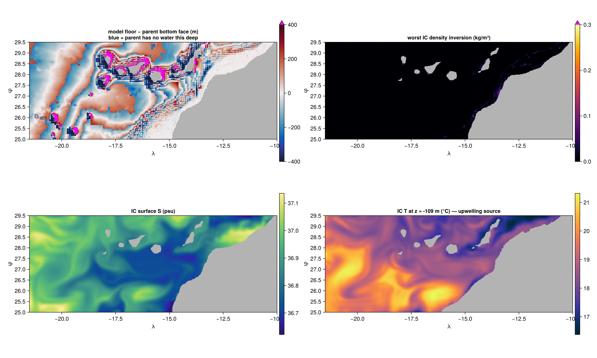
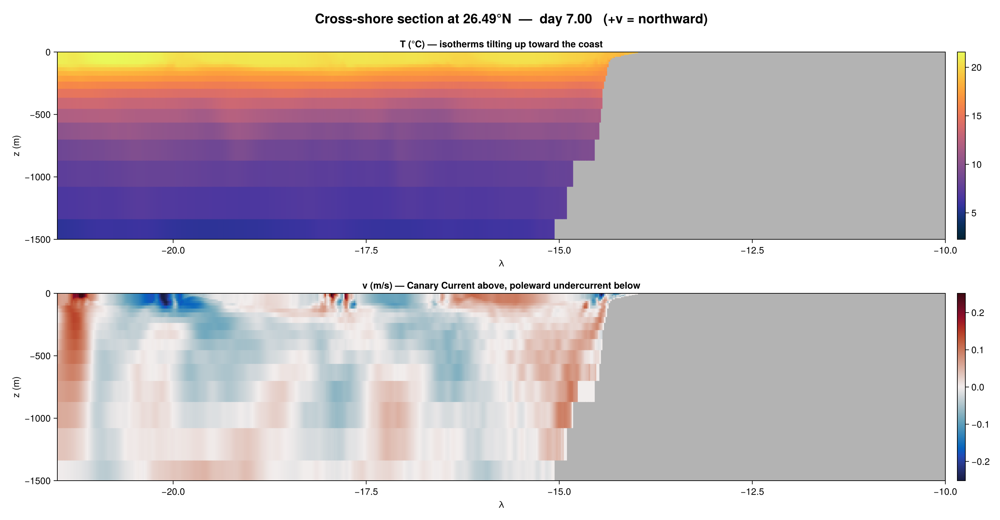
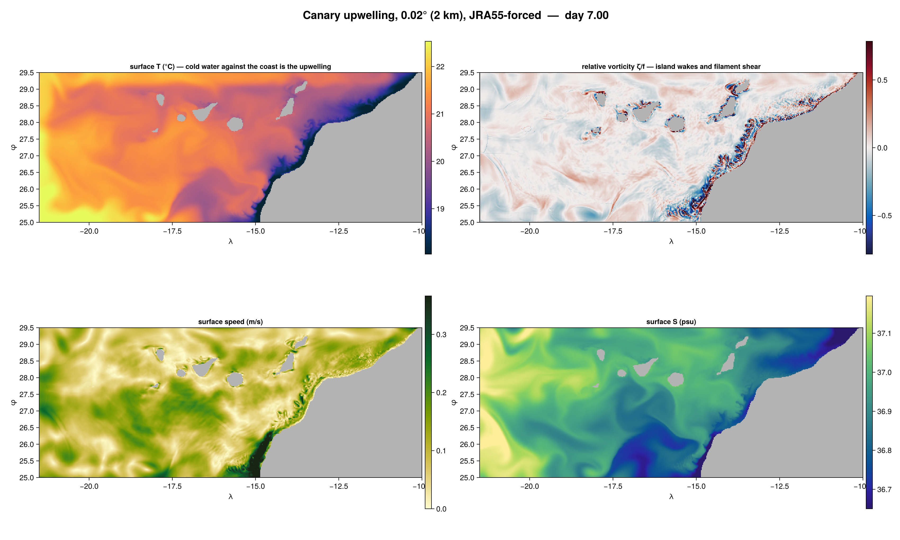

# Canary upwelling configuration (NW Africa)

Third OBC test domain. **Status: validated in both seasons — stable 7-day JRA55-forced runs at
0.02° (2 km), January (38.8 h) and July (36.3 h) — plus two 90-day GPU tracer runs, at φ_S = 25.0
(13.6 h) and φ_S = 22.0 (1.29 days), which together answer the domain-sizing question: at 90 days
the 25°N domain was already large enough. See `domain-sizing.md`.**
Model: `canary/canary_glorys_obc.jl`.

## Why this domain

Each domain so far has tested one thing the previous could not.

| | Salish Sea | Red Sea | **Canary** |
|---|---|---|---|
| open boundaries | 2, in 1–2 parent cells | 1, well resolved | **3, all in deep open ocean** |
| unresolved feature | none — parent could not resolve the channels either | Bab el-Mandeb, inside | **island wakes + upwelling filaments** |
| interior driver | rivers (outside the domain) | evaporation | **wind** |

This is the first domain where **the atmosphere is the point rather than a correction**. It was
considered and rejected when the Red Sea was chosen — "cleanest boundaries but needs wind forcing this
config has none of" — and became viable only once JRA55 was wired and validated in `red_sea/`.

## Verified geometry

Measured from ETOPO via `regrid_bathymetry`, not assumed.

| | |
|---|---|
| Domain | 21.5–10.0°W, 25.0–29.5°N |
| Open boundaries | **west, south, north** — the east edge at 10°W is entirely land (African coast) |
| West (−21.5) | 100% wet, 1 segment, 4578–4885 m, **2388 km²** |
| North (29.5) | 99% wet, 1 segment, 30–4885 m, **3504 km²** |
| South (25.0) | 58% wet, 1 segment, 14–4584 m, **1712 km²** |
| Wet fraction | **72.7%** (Red Sea 16.1%, Salish Sea 6.4%) |
| Max depth | 4885 m at −21.48°E, 29.48°N — the NW boundary corner |
| Median wet depth | 3504 m |

Combined open-boundary area is **7.6e3 km²**, ten times the Red Sea's 719 km².

All six major islands resolve, even at the 0.1° smoke resolution (La Palma 6/16 land cells,
El Hierro 2/16, Tenerife 12/16, Gran Canaria 14/16, Fuerteventura 10/16, Lanzarote 6/16). The startup
check reports these counts — over-smoothing dissolves the wake-generating topography silently, so
check before trusting a run.

## The depth constraint — opposite in sign to the Red Sea

GLORYS's **deepest valid level over this region is −4836.6 m**, and only 2.9% of columns have data
there. Raw ETOPO reaches 4885 m, so **the model floor would sit below the parent** — the Salish Sea
failure condition. The Red Sea had +50 m of headroom; this has −48 m.

It is cheap to fix because the deep water is rare:

| deeper than | columns | |
|---|---|---|
| 4700 m | 803 | 5.3% |
| **4800 m** | **181** | **1.2%** |
| 4836 m | 48 | 0.3% |

**`depth = 4800` is a hard cap, not a convenience.** It clips 1.2% of columns by at most 85 m of
abyssal plain and keeps every model cell inside the parent's valid data. Do not raise it.

## Parent data — `glorys_interior_check.jl`

Adapted from `red_sea/`. Numbers at **0.02°, 1993-01-01**: 93,973 wet columns, 2,626,186 wet cells.

**Coverage.** 88.65% of wet columns sit below the parent's deepest valid *centre*, but only **1.68% of
wet cells** do — the deficit is a thin sliver at the bottom of many columns, not a systematic hole.
Where it matters most it barely exists:

| boundary | wet columns | cells below parent |
|---|---|---|
| west | 225 | **0 / 7200 (0.00%)** |
| south | 332 | 73 / 8663 (0.84%) |
| north | 569 | 178 / 16479 (1.08%) |

**Provenance.** No non-physical values. Water masses are a textbook North Atlantic column:

| band | S (median) | T (median) |
|---|---|---|
| surface / Ekman | 36.933 | 20.55 |
| upwelling source (100–300 m) | 36.489 | 17.57 |
| NACW/AAIW (300–1000 m) | 35.604 | 11.12 |
| NADW (1000–3000 m) | 35.148 | 4.67 |
| abyssal | 34.918 | 2.21 |

**Stability — much cleaner than the Red Sea.** 40,321 unstable pairs (1.59%), but the tail that
matters is **5 pairs at Δρ ≥ 0.1, worst 0.133 kg/m³**, against 700 pairs at worst 0.92 for the Red Sea.
All five sit in the top 12 m at La Palma and the shelf, in columns where GLORYS has land and the model
has water. This domain has no hypersaline coastal water for horizontal inpainting to import, which was
the Red Sea's actual failure mechanism.



## The GLORYS residual, and the no-correction decision

There is **no net-transport correction**, following the measurement in `red_sea/` that a Flather
boundary absorbs the parent's spurious net transport unaided. That was measured at 1.44e5 m³/s; here
the residual is ~18× larger, so this domain is the sharpest available test of that decision.

| | Canary (0.02°) | Red Sea |
|---|---|---|
| net residual at t = 0 | **−2.033e6 m³/s** | −1.44e5 |
| per boundary at t = 0 | west −5.31e6, south +2.10e6, north +1.18e6 | — |
| typical net once running | −2.6e6 | — |
| uncompensated sea level | **−0.55 m/day** | −0.03 m/day |
| η offset Flather needs | 0.69 cm | 0.04 cm |

**The decision holds.** At t = 2 days the residual reads **−2.605e6 m³/s** while the model's actual net
transport through the same three sections is **+1.345e5 m³/s** — the boundary absorbs ~95% of a 2.6 Sv
imbalance without help, and volume drift sits at −3.0e-6 with mean S flat. The Red Sea conclusion
extrapolates to 18× its measured magnitude.

The west edge dominates the residual, which is the Canary Current: a few Sv through a 2388 km² section
is physically ordinary, and it is the *net* that has to close.

> **Earlier versions of this file claimed −5.009e6 m³/s and "35× the Red Sea".** That was wrong on two
> counts: it was measured at 0.1° rather than the run resolution, and it included an off-by-one in the
> north-boundary diagnostic (sampling y-face `Ny`, an interior face, instead of `Ny+1`, the domain
> edge). Correcting the index moved the north residual by 3.5 Sv *and flipped its sign*. The boundary
> *conditions* were never affected — `north_V_obc` and `v_north_exterior` always used `Ny+1` — only
> the diagnostics were.

## Layered transports: comparing to the Canary Current literature

Full-depth net transport is the volume budget, not a quantity any paper reports. The inverse box
models (Hernández-Guerra 2005; Pérez-Hernández 2013; Casanova-Masjoan 2020) integrate over **neutral
density (γⁿ)** layers — thermocline γⁿ < 27.38, intermediate 27.38–27.922, deep > 27.922.

γⁿ needs the Jackett & McDougall lookup, which this stack does not have, so **σθ = ρ(T,S,0) − 1000
stands in**. Two consequences, both measured rather than assumed:

- **The deep threshold had to move.** σθ in this domain maxes at **27.798**, so a γⁿ = 27.922 bound is
  unreachable and the deep bin reads zero. It is set to **27.70**, which is NADW here.
- **The layers sit too deep.** The run prints where each σθ surface actually lies:

  | surface | our σθ | literature γⁿ |
  |---|---|---|
  | 26.85 | **406 m** (median) | ~80–320 m |
  | 27.38 | **1195 m** | ~700 m |

  So our "thermocline" swallows the AAIW the literature counts as intermediate and **reads high**
  against their numbers. Quote it with that caveat.

**Fixed-depth bins would be worse, not simpler.** Isopycnals heave seasonally, so a fixed split aliases
that heave into apparent transport change — corrupting exactly the January-versus-July comparison the
diagnostic exists to make.

Early result at t = 2 days, thermocline layer: **north +5.7 Sv (inflow), south +2.0, west −3.2**.
The north inflow is the Canary Current entering the domain and compares well with Hernández-Guerra's
**4.7 ± 0.8 Sv southward** north of the islands, allowing for the deep-layer bias. The **south reading
+2.0 Sv inflow is not yet explained** — the Canary Current picture says the flow should leave through
the south — and it has been persistently positive, so it is not noise.

All three boundaries are also **saved as sections** (plus a separate `north_face_v` at `Ny+1`, since
face-in-y indexing cannot put `v` and `T`/`S` in one slice), so the layer definition can be re-binned
offline — including with a proper γⁿ implementation later — without re-running.

## Resolution and cost

| Δ | km at 27.25°N | cells | 7-day run |
|---|---|---|---|
| 0.1° | 9.9 | 0.17 M | smoke tests only |
| 0.05° | 5.0 | 0.66 M | ~2 h |
| **0.02°** | **2.06** | **4.1 M** | **~73 h measured** (not the ~21 h extrapolated) |
| 0.01° | 1.03 | 16.6 M | ~7 days — GPU/HPC only |

The domain is 7× smaller in area than the Red Sea, which is why 2 km is affordable here when it was
not there. **0.02° is the CPU validation resolution**; 1 km is the target for island wakes and
upwelling filaments and needs a GPU.

**The 21 h figure was wrong and the reason is worth recording.** It scaled Δt from the Red Sea by grid
spacing, but the binding constraint here is **vertical, not horizontal**: with a 1.4 m surface cell and
wind-driven convection, Δt settles at 1.4–3.3 min where the horizontal CFL alone (max|u| ≈ 0.5 m/s over
2 km) would allow ~7 min. At ~40 s/iter that is **~73 h for 7 days**. Raising `z_scale` would buy
timestep at the cost of the surface resolution that motivated `scale = 700`.

## Vertical grid

`Nz = 32`, `depth = 4800`, `z_scale = 700` → **1.21 m surface cell, 11 levels in the top 50 m, 16 in
the top 150 m**, at the cost of ~930 m bottom cells.

That trade is deliberate: upwelling lives in the Ekman layer and the top few hundred metres, and the
source water for coastal upwelling here is around 100 m. The abyss is quiescent and can carry coarse
cells. 32 levels over 4800 m is 50% more depth than the Red Sea on the same budget, so the deep
resolution is genuinely thin — a limitation for anything involving deep water masses.

z\* is on in every run so far, as in `red_sea/`: with a 1.2 m surface cell the O(max|η|/Δz_top) error of a
static (linear free surface) grid is not small. `use_zstar: ["false"]` falls back.

## Differences from the other scripts

- **Three open boundaries.** `salish_sea/` is the template (west + north); south is new. Inflow is
  `+u` at west, `+v` at south, `−v` at north. Oceananigans applies the side-dependent Flather sign
  itself, so the closures return the exterior value only — **do not pre-flip signs**, which is exactly
  the double inversion `red_sea/` carried through its whole validation run.
- **Sponge on all three edges**, combined with `max()` so corners do not double-count. 0.25°
  (`sponge_width_deg`) — the upwelling front sits against the eastern coast, far from every sponge.
- **An upwelling index in the progress output**: coastal minus offshore SST at matched latitudes, plus
  mean temperature at the ~100 m source depth. This is the signal the domain exists to produce, and
  the other two configurations needed no equivalent. At initialisation it reads **ΔT = −2.25 °C** —
  the upwelling is already in GLORYS; the question is whether the model holds or sharpens it.
- **No net-transport correction** (see above).

## Parameters

`canary_glorys_obc.jl` carries the 90-day reference configuration inline. The column below is what
it holds as committed; the knobs listed are read from the environment.

| parameter | reference value | |
|---|---|---|
| `delta_deg` | `0.02` | horizontal resolution, degrees |
| `start_date` | `1993-01-01` | run start |
| `depth` | `4800` | **hard cap** — see the depth section |
| `z_scale` | `700` | vertical stretching |
| `sponge_width_deg` | `0.25` | nudging band width, degrees |
| `atmosphere` | `JRA` | `JRA` or `none` (boundary-only control) |
| `jra_dataset` | `repeat` | `repeat` or `multiyear` |
| `use_zstar` / `bathymetry_passes` / `weno_order` / `stop_days` / `run_tag` | | as in `red_sea/` |

The other 48 are in the config, grouped and commented.

## Validation — 7-day run at 0.02°, JRA55-forced, January

3620 iterations, **38.8 h wall** at ~40 s/iter, Δt settling at 1.4–4.5 min.

### The no-correction decision holds at 21× the magnitude it was measured

This is what the domain was chosen to test. Mean over t ≥ 4 d:

| | |
|---|---|
| GLORYS residual through the three sections | **−3.033e6 m³/s** |
| model's actual net transport | **+2.5e4 m³/s** |
| **absorbed by the Flather boundary** | **99.2%** |
| volume drift | −1.2e-6 |
| salt drift | +2.7e-6 |
| mean S | 35.3068 → 35.3069 |

`red_sea/` measured the no-correction conclusion at 1.44e5 m³/s. It extrapolates to **21× that**
without a correction term and without drift.

### The Canary Current is there — but the first diagnostic hid it

The on-the-fly thermocline transport drifted from **+8.5 Sv (north inflow) at day 0.5 to −0.5 Sv
(outflow) at day 7**, which read as the model losing the Canary Current. It was not. Re-binning the
saved boundary sections offline into finer density bands (mean over t ≥ 4 d, Sv, + = into the domain):

| band | mean depth | west | south | north |
|---|---|---|---|---|
| σθ<26.5 | ~70–110 m | −0.81 | +0.21 | −0.09 |
| 26.5–26.85 | ~210–330 m | −1.01 | +0.51 | **+1.28** |
| 26.85–27.1 | ~420–520 m | −1.11 | +0.52 | **+4.58** |
| 27.1–27.38 | ~780–840 m | −2.10 | **+4.38** | **−4.78** |
| 27.38–27.70 | ~1250–1470 m | +0.28 | **+5.27** | **−2.60** |
| σθ>27.70 | ~2800–3200 m | −1.29 | −2.78 | −0.41 |

Two opposing currents sat inside the single σθ<27.38 bin:

- **Above ~500 m: north inflow totalling +5.8 Sv** — the Canary Current, southward through the
  domain. Compares well with Hernández-Guerra's **4.7 ± 0.8 Sv** north of the islands, allowing for
  the layer sitting deeper than theirs.
- **700–1500 m: north outflow, south inflow, ~4–5 Sv** — a **poleward undercurrent**, flowing the
  opposite way. A real feature of this eastern boundary (*The Canary Intermediate Poleward
  Undercurrent*, JPO 2021), and visible in the cross-shore section as a northward band hugging the
  African slope.

As the undercurrent spun up over the run it overwhelmed the surface signal and flipped the sum's sign.
**The bin has since been retuned to σθ < 27.10 (~500 m)** — matching the *depth* the literature's
γⁿ < 27.38 layer occupies rather than its numerical label, since σθ ≠ γⁿ.

This is what the saved boundary sections bought: the diagnosis needed re-binning, and re-binning from
file cost minutes where re-running would have cost 39 hours.

### Upwelling: present, unchanged, and weakly tested

`ΔT` (coastal minus offshore SST) went **−2.260 → −2.289 °C**, mean −2.268 over t ≥ 4 d. The model
neither sharpened nor destroyed the gradient GLORYS supplied. Temperature at the 109 m source depth
over the shelf held at 17.53 °C. **January is the weak season here** — this is a null result on the
domain's headline signal, and the July run is the real test.



### Open after this run

- **The undercurrent at 4–5 Sv looks large** for an eastern boundary undercurrent (typically O(1 Sv)).
  No literature value was found to check it against.
- **~4 Sv of apparent transfer from upper to deeper layers** in the mean, too large to be real
  diapycnal flux. Most likely isopycnal heave changing layer volumes, since the binning is
  instantaneous — not verified.
- **The thermocline circulation was still drifting at day 7**, so 7 days does not settle this domain's
  transports any more than it settled the Red Sea's strait.

## July vs January — the upwelling signal

Same configuration, same resolution, 7 days each. `start_date: ["1993-07-01"]`, 3030 iterations,
**36.3 h wall**.

### The headline: the child sharpens the gradient in the strong season

Coast-following index, both recomputed **offline on the same definition** so the comparison is
like-for-like (January ran before the index was fixed):

| | day 0.25 | day 7 | change over the run | mean t ≥ 4 d |
|---|---|---|---|---|
| January | −1.233 | −1.246 | **−0.013 °C** | −1.227 |
| **July** | −1.997 | −2.197 | **−0.200 °C** | −2.204 |

July's contrast is **~1.8× stronger in absolute terms and sharpens 15× more** over the run. In the
weak season the model essentially holds what GLORYS supplied; in the strong season it actively deepens
the gradient. That is the 2 km child doing work the 9 km parent cannot — the question this domain was
built to ask.

> **Two earlier readings in this file were wrong and are corrected here.** July's initial contrast was
> reported as *weaker* than January's (−1.72 vs −2.26); that came from the broken fixed-longitude index
> which sampled only the northern coast. On the corrected index July is stronger from the start, the
> opposite conclusion. And a mid-run estimate of "10× more sharpening" is 15× on the coast-following
> index (5× on the old one) — the direction held, the number moved.

### Canary Current

| σθ < 27.10 | north | south | west |
|---|---|---|---|
| January (offline re-bin) | +5.77 | +1.24 | −2.94 |
| **July** | **+4.94** | **−2.91** | −1.70 |

July shows the proper through-flow — in at the north, out at the south — and the **−2.91 Sv south
outflow sits inside the literature's summer estimate of −2.5 ± 1.4 Sv**. January's south limb is
*inflow*, which does not match the winter estimate of −0.8 ± 1.1 Sv, though that error bar spans zero.

### Boundary absorption holds in both seasons

| | GLORYS residual | model net | absorbed |
|---|---|---|---|
| January | −3.03e6 m³/s | +2.5e4 | 99.2% |
| **July** | **−3.56e6** | **+8.8e3** | **99.75%** |

The `red_sea/` no-correction decision, measured at 1.44e5 m³/s, now holds across two seasons at
~21–25× that magnitude.

### Other seasonal differences

| | January | July |
|---|---|---|
| evaporation | −0.92 m/yr | **−1.97 m/yr** |
| mean S over the run | flat (35.3068→35.3069) | **rising (35.3148→35.3161)** |
| worst IC-driven Δρ | 0.205 | **0.392** |
| max \|ζ/f\| in the surface field | **1.26** | 0.79 |

Summer evaporation concentrates salt, exactly as `red_sea/` showed. Note the vorticity extreme runs the
*other* way: January reaches higher |ζ/f| offshore, while July's vorticity is weaker but concentrated
in a narrow coastal strip along the upwelling front — visible in the animations.



## Passive tracer release

`use_tracer: ["true"]` adds a continuous point release for pathway and residence-time work — the kind an
ocean alkalinity enhancement outfall would represent.

**Two tracers, not one**, following Deleersnijder's age formulation:

```
∂c/∂t  + ∇·(uc)  = S     concentration; S is the release
∂ac/∂t + ∇·(uac) = c     age concentration
```

so **mean age = ac/c**. A single "ideal age" tracer cannot do this for a point source: it measures time
since surface contact, not time since release.

| | |
|---|---|
| default site | Las Palmas, **−15.38°E, 28.16°N** — wet, 535 m, 47 of 49 neighbouring cells wet, the island's main port |
| shape | **2-D Gaussian at the surface**, σ = 0.02° (`release_sigma_deg`) — one grid cell at 0.02° (1.98 km zonal, 2.22 km meridional) — cut off at 3σ |
| depth | top model cell only, 1.5 m (`release_depth_m`); the top cell is 1.21 m thick |
| source | normalised to **∫S dV = 1 unit/s**, so cumulative input equals elapsed seconds |
| boundaries | **zero-value at all three open edges** — the default no-flux would trap tracer and make residence time meaningless |

That normalisation makes the budget checkable by inspection rather than by trusting the advection
scheme. Verified on CPU: **inventory 99.97% of released**, with export at ~1e-25 (nothing had reached a
boundary yet), tracer confined to the release cell, and the age tracer accumulating correctly.

**This needs a much longer run than 7 days.** Residence time in this region is weeks to months, which
at ~39 s/iter is days of wall clock — a GPU run. The release forcing is a continuous-form pure function
of `(x,y,z,t)` specifically so it runs unchanged on GPU, but **the diagnostics are not GPU-ready**: they
index model fields directly, which GPU disallows. That refactor (CPU field copies plus a CPU grid for
the metric operators) is the remaining blocker.

## Running on GPU

`use_gpu: ["true"]`. The long tracer runs need it: residence time in this region is weeks to months,
which at ~39 s/iter on CPU is days of wall clock.

The boundary conditions and the tracer forcing were already device kernels — the release source is a
continuous-form pure function of `(x,y,z,t)` rather than a masked array for exactly this reason. The
**diagnostics** were the obstacle: they all walk the grid cell by cell, which a device array will not
allow. They now operate on host copies:

- `grid_c` — a CPU mirror of the grid, because the metric operators (`Vᶜᶜᶜ`, `Axᶠᶜᶜ`, `Azᶜᶜᶜ`) read the
  grid's own coordinate arrays, so the grid must be on the host too.
- `arr(f)` — one device→host copy per field per progress block (~17 MB each at 0.02°, every 10
  iterations; negligible against the step cost).
- Setup-time work that samples the parent point by point — the initial condition, η, `fill_down!` —
  routes through host copies of the parent series.

**`sync_grid_c!` is load-bearing under z\*, and the reason is not obvious.** On CPU,
`on_architecture(CPU(), grid)` *shares* the z\* state arrays (σ, η, ∂t_σ), so the mirror's metrics
track the live grid for free. **On GPU it is a genuine copy.** Without an explicit sync every
diagnostic would read metrics frozen at the rest state — including `salt_and_volume`, which exists to
measure z\* drift and would then report ≈0 regardless of what z\* actually did. That is a
plausible-looking wrong answer on a months-long run, not a crash. The sync copies the z\* state
host-ward once per block and is a no-op on CPU.

**Cost at the target resolution.** 0.02° (575 × 225 × 32, 2.6 M wet cells) runs at **1.8 s/iter** on an
L4 using **2.95 GB** of GPU memory — so memory is not a constraint and a larger grid or a second tracer
would fit. With Δt settling at 1.4–4.5 min, a 3-month tracer run is **~15–22 h** (≈ $13–19 at
g2-standard-8 rates). Output at 0.02°: a 3-D snapshot is ~230 MB per frame (daily over 3 months ≈ 21 GB,
every 3 days ≈ 7 GB); 6-hourly surface + boundary sections over 3 months are ~3 GB together.
`output_hours`, `snapshot_hours` and `progress_iters` set the cadences.

**Verified on GPU, against CPU.** The full configuration — JRA55 atmosphere, tracer release, three
open boundaries, nudging, z\* — runs on an NVIDIA L4 and matches a CPU run of the same configuration in
every model-state diagnostic over 16 blocks at 0.1°: velocities, η, T and S ranges, layered boundary
transports, salt and volume drift, unstable pairs, surface freshwater flux, the upwelling index, tracer
inventory and mean age. The only differing numbers are tracer export through the open boundaries at
magnitudes ≤ 1e-25 /s, i.e. round-off on a tracer that has not reached any boundary. The ocean-only
configuration matches identically too. **0.08 s/iter on GPU against 1.13 s/iter on CPU** at 0.1°.

Getting there needed four changes, recorded because each fails in a way that is not obviously
diagnosable (see also `../ENVIRONMENT.md`):

1. **Boundary exteriors precomputed** — below.
2. **`using CUDA` must execute**, and kernel-read globals must be `const` — below.
3. **`ZeroField()` defaults to `Float64` on GPU.** NumericalEarth's `_assemble_net_ocean_fluxes!`
   hits `CUDA_ERROR_ILLEGAL_ADDRESS` while the coupled model is built. Reproduced in a minimal script
   with none of this configuration's code (stock `ocean_simulation` + JRA55 + `OceanOnlyModel` on a
   small regional grid). Every array argument checked out on-device and in bounds; the same kernel call
   runs with the placeholder `ZeroField`s typed `Float64` and fails with the default `Int`, in the same
   process. Integer `ZeroField`s do work in other kernels, so it is specific to this call — likely an
   upstream compiler issue. The override is one line in the GPU-only block, and cannot change results:
   the GPU run (with it) and the CPU run (without) are identical.
4. **The age tracer's source is a callback, not a `Forcing`.** A forcing with
   `field_dependencies = :c` makes the tracer tendency kernel use `model_fields`, which drags in a
   free-surface property access that fails GPU compilation (`InvalidIRError`, `ijl_get_nth_field_checked`
   in `free_surface_fields`). `ac .+= Δt·c` after each step instead lags advection by one Δt; on CPU it
   matches the forcing version in every non-age diagnostic and in tracer inventory, with mean age equal
   to three decimals of a day.

Items 3 and 4 are workarounds for dependency behaviour and should be revisited when NumericalEarth or
Oceananigans is upgraded.

**Boundary exteriors are precomputed, not sampled in the kernels.** The first GPU attempts never
reached a timestep: compiling the boundary-condition halo fills sent the CUDA compiler's inliner past
31 GB, because the kernels called `interpolate_to_grid` on NumericalEarth series with deeply parametric
types. The parent is now interpolated onto the three boundary faces once at setup, into
(face × depth × time) arrays passed as boundary-condition `parameters` and interpolated linearly in
time in the kernel.

With a static vertical grid this is **exactly** equivalent to the old sampling (identical output over
11 diagnostic blocks, old vs new, `use_zstar: ["false"]`). Under z\* it is not: the old kernels sampled the
parent at depths displaced by the free surface each step, the precomputed arrays sample at rest-state
depths. That moves boundary transports by 0.1–0.9% and salt drift by ~0.1% on the 0.1° smoke test —
small against the parent residual the boundary already absorbs, so accepted rather than corrected.
Runs before this change are therefore not bitwise comparable with runs after it.

Two smaller GPU requirements, both now in the script: `using CUDA` must actually execute (Oceananigans
defines `GPU()` in its CUDA extension, so having CUDA in the project is not enough), and globals read
inside kernels — the sponge edges, the release geometry — must be `const`.

One thing was tried and reverted: precomputing the GLORYS residual at setup and interpolating in time.
The parent's time interpolation is exactly linear (verified pointwise to ~1e-13), so that part was
sound — but precomputing also froze the **section areas** at their rest state, and under z\* those
breathe with the free surface. It shifted the diagnostic by a few tenths of a percent against the
validated baseline, so it is computed live on host copies instead.

## Long runs: output cadence, checkpoints and restarts

| parameter | reference value | |
|---|---|---|
| `output_hours` | 6 | surface **and** boundary sections (they share a schedule) |
| `snapshot_hours` | 72 | 3-D snapshots — the volume driver, ~230 MB/frame at 0.02° |
| `progress_iters` | 10 | `progress` copies every 3-D field to the host and loops over all wet cells |
| `checkpoint_days` | 10 | one checkpoint kept at a time (`cleanup`), ~560 MB at 0.02° |
| `pickup` | — | `auto` takes the newest checkpoint for this tag, or give a path |

**Restarts need a custom reader, and the reason is a trap.** `Checkpointer(ocean.model; …)` does *not*
checkpoint the ocean model: the writer serialises whatever model its simulation holds, which here is the
coupled `EarthSystemModel`. Oceananigans' `set!(model, filepath)` then cannot read it —
`checkpointer_address` and `set!` have no methods for that type, and NumericalEarth adds none — so both
`run!(pickup=true)` and `set!(ocean.model, file)` fail. `restore_ocean_state!` reads the file directly
(velocities, all tracers including `c` and `ac`, free-surface displacement and barotropic velocities, the
clock) and carries the clock across to the coupled model.

Verified at 0.1°: a run checkpointed at iteration 104 (t = 17.28 min) resumed there, continued with
fields unchanged (max|u| 0.126 against 0.127 before the stop) and the tracer intact (inventory 100.01% of
released, mean age preserved). **Not restored: timestepper tendencies** — the checkpoint contains none, so
the first step after a restart is first-order rather than second. One step per restart is negligible over
months, but a restarted run is not bitwise identical to an uninterrupted one.

## Status and what is untested

Smoke-tested end to end at 0.1°: all three boundaries carry transport, z\*, JRA55, the conservation
and stability monitors, the upwelling index and the output writers all engage. Drift ~1e-6 over the
test. Not yet established:

- ~~No validation run.~~ **Done** — 7 days at 0.02°, stable, 38.8 h.
- ~~The GLORYS residual is untested against the no-correction decision.~~ **Done** — 99.2% absorbed.
- ~~July is not run.~~ **Done** — the domain's headline signal is confirmed: 15× more sharpening than
  January.
- ~~The tracer release has not been run in production.~~ **Done** — 90 days at 0.02° on GPU, 13.6 h
  wall, **88.8% of the release still in the domain at day 90**, ~81% of the loss through the south
  boundary. Residence timescales and the domain-size implications are in
  `domain-sizing.md`.
- ~~A domain-sizing run has not happened.~~ **Done** — 90 days at `lat_south: [22.0]`, 1.29 days on
  an L4, identical to the 25°N run but for the southern boundary. Retention saturates: going from
  352 km to 574 km of southward distance buys **0.44 percentage points** (90.90% → 91.34% at day 90),
  so **the 25°N domain was already large enough at 90 days**. The virtual-boundary method that said
  so predicted the real domain to within ~4 points, and its extrapolated thresholds to 7–16% in
  distance. It also under-estimates rather than over-estimates retention, the opposite of what was
  assumed. See `domain-sizing.md`.
- ~~The diagnostics are not GPU-ready.~~ **Done** — see *Running on GPU*. The full configuration runs on
  an L4 and matches CPU at 0.1°, and runs at 0.02° (**1.8 s/iter, 2.95 GB of the L4's 24 GB**).
- **GPU/CPU equivalence was checked at 0.1°, not at 0.02°** — a CPU run at the finer grid costs ~39 h.
- **January is the weak-upwelling season.** The window matches `salish_sea/` and `red_sea/`, but
  Canary upwelling peaks in boreal summer at these latitudes. `start_date: ["1993-07-01"]` gives the
  strong case, and the domain's own signal will be clearer there.
- **The south boundary is only 58% wet** — the African coast cuts through its eastern end, where a
  sponge meets a coastal boundary. Structurally the least clean part of the domain, and the most
  likely place to need the boundary moved rather than the sponge tuned.
- **Deep resolution is thin**: ~930 m bottom cells. Fine for upwelling, not for deep water masses.
- **1 km is untested** and is where island wakes and filaments actually live.
