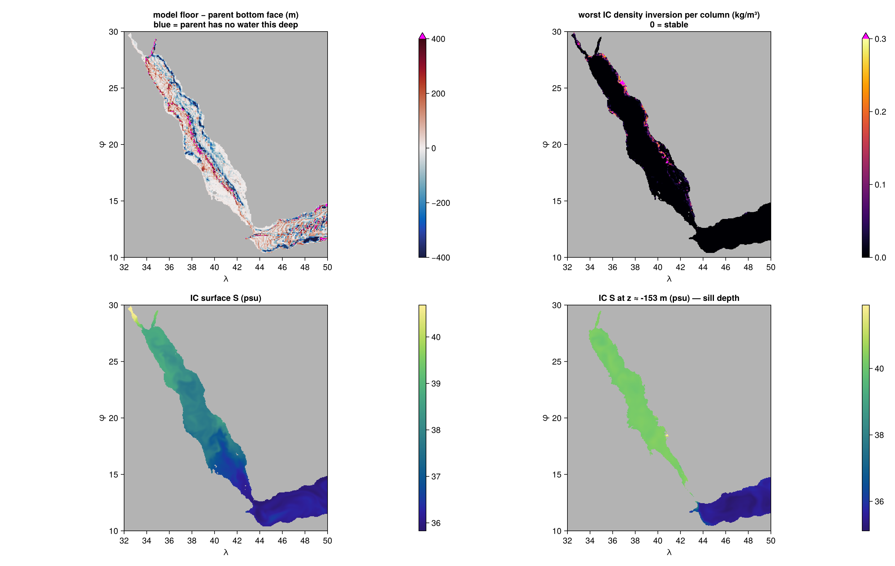
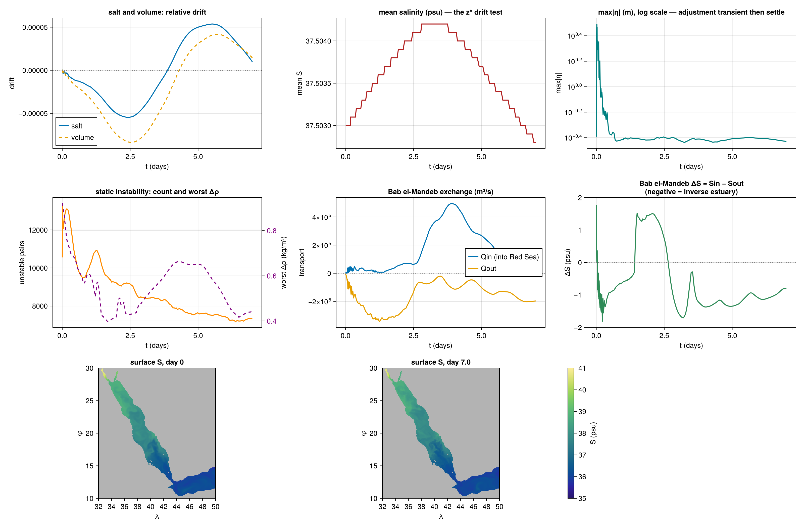
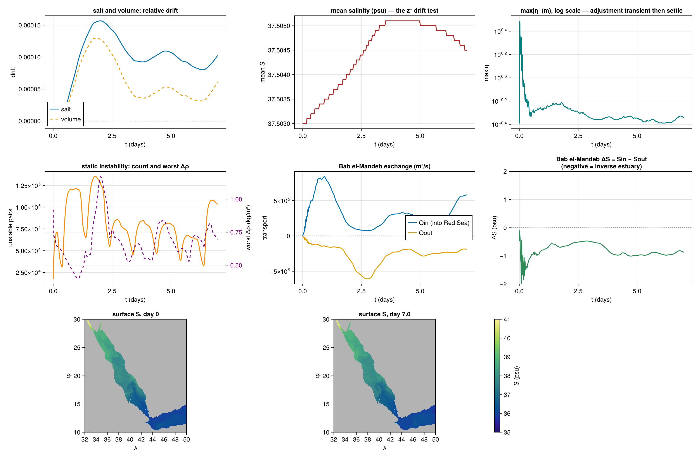
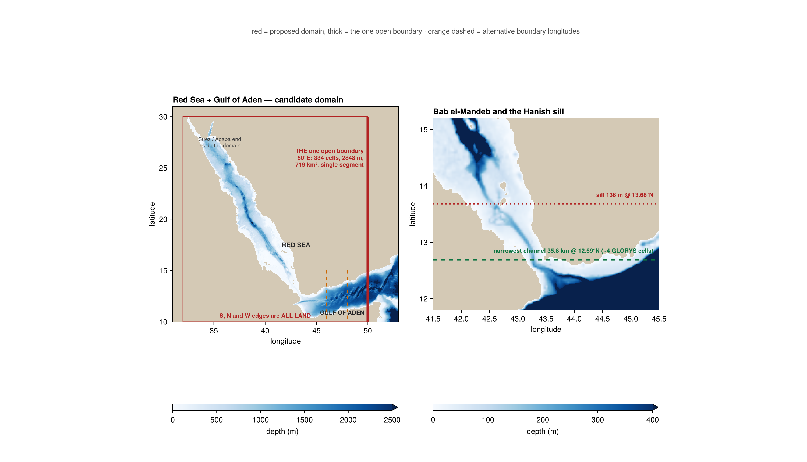

# Red Sea + Gulf of Aden configuration

Second OBC test domain, adapted from `salish_sea/`. **Status: validated both unforced and JRA55-forced —
stable 7-day runs at 0.05° (5.2 km). Strait transports are not yet converged; see below.**
Model: `redsea_glorys_obc.jl`.

| flag | default | |
|---|---|---|
| `REDSEA_DELTA` | `0.05` | horizontal resolution in degrees |
| `REDSEA_ATMOS` | `JRA` | `JRA` or `none` |
| `REDSEA_JRA_DATASET` | `repeat` | `repeat` (cached) or `multiyear` (~12 GB download) |
| `REDSEA_ZSTAR` | `1` | `0` falls back to static z |
| `REDSEA_PASSES` | `5` | bathymetry smoothing passes |
| `REDSEA_WENO_ORDER` | `7` | tracer advection order |
| `REDSEA_STOP_DAYS` | `7` | run length |
| `REDSEA_TAG` | `""` | appended to output filenames, so an A/B run cannot clobber a baseline |

## Why this domain

The Salish Sea tested the boundary machinery but could never test the thing nesting is *for*:
channels there were 5–20 km against a 9 km parent, so GLORYS could not represent the geometry it was
forcing. Here the open boundary sits in deep open ocean the parent resolves well, while
**Bab el-Mandeb (~36 km, ~4 GLORYS cells) is inside the domain** for the model to resolve.

Selected over Gulf of Mexico (Mississippi freshwater, chaotic Loop Current makes attribution hard),
North Sea (tide-dominated shallow shelf — every Salish difficulty at larger scale) and Canary
upwelling (cleanest boundaries but needs wind forcing this config has none of).

## Verified geometry

All measured from ETOPO via `regrid_bathymetry`, not assumed:

| | |
|---|---|
| Domain | 32–50°E, 10–30°N |
| Open boundaries | **east edge only** — south (10.0N), north (30.0N) and west (32.0E) are all land |
| East section at 50°E | single segment, 334 cells over 11.52–14.85°N, 2848 m deep, **719 km²**, ~37 GLORYS cells across |
| Hanish sill | **136 m at 13.68°N** (literature ~137 m) |
| Narrowest main channel | **35.8 km at 12.69°N**, ~4 GLORYS cells |
| Max depth | 3176 m, at 49.58°E / 13.18°N — in the Gulf of Aden beside the boundary |
| Red Sea proper | max 2478 m, **median 425 m** |
| Wet fraction | 16.1% (Salish Sea was 6.4%) |

For scale: the Salish Sea west boundary was **1.6 km²** in 1–2 parent cells. This one is 450× larger
and in water GLORYS resolves.

Suez and Aqaba terminate naturally inside the domain, so no artificial closure is needed.

## GLORYS validity at the boundary

The Salish Sea instability came from GLORYS having no valid data below 320 m there while the
bathymetry reached 353 m. Same check here, over a box straddling the boundary (49–51°E, 10.5–16°N):

```
DEEPEST GLORYS LEVEL WITH VALID DATA: -3226.1 m     (100% valid at every level above)
domain max depth                    : -3176 m
```

**50 m of margin**, and the profile is physically right — a salinity maximum of 35.50–36.37 at
460–770 m, which is the Red Sea Outflow Water signature spreading into the Gulf of Aden. So the
parent supplies the right water masses at the boundary, not merely numbers.

**Consequence: `depth` must stay ≤ ~3200 m.** Rounding it up would put model cells below the parent's
valid data and recreate the Salish failure exactly.

That 50 m is a **boundary-box number and does not generalise** — the interior is a different and much
worse story. See the next section.

## GLORYS validity in the interior

`glorys_interior_check.jl` — read-only, ~65 s at 0.05°, runs offline off the GLORYS cache. Builds the
same grid and bathymetry as the model, then asks three questions in increasing order of what actually
matters. `REDSEA_DELTA` / `REDSEA_PASSES` as for the model; `REDSEA_CHECK_CONTROL=1` adds the
`fill_down!` control in stage 3.

Numbers below are at **0.05°** (23,194 wet columns, 497,165 wet cells, 1993-01-01).

### 1. Coverage — where does the parent run out of water?

Per column, against the deepest GLORYS level with valid data at the *nearest* parent column:

| | |
|---|---|
| wet columns whose floor is below the parent's deepest water | **51.7%** |
| wet columns below the parent's deepest valid cell *centre* | 69.8% |
| wet **cells** below the parent's deepest valid centre | 31,724 of 497,165 (**6.4%**) — Red Sea 8.3%, Gulf of Aden 3.1% |
| face-margin quantiles | median −3 m, 5% −298 m, 1% −566 m, min −1254 m |
| wet columns whose nearest parent column is **entirely land** | 592 (2.55%) |

GLORYS's Red Sea is simply shallower than ETOPO's. The deficit is not scattered: it is a band along
the coastline and the axial trough (panel 1 of the figure). The entirely-dry columns include several
**at Bab el-Mandeb itself** (43.07–43.43°E, 12.6–13.6°N) — the parent has land where the model has
the strait the domain exists to resolve. That does not touch the boundary condition, which is at 50°E
in deep water, and the strait is far outside the sponge, so it reaches the model only through the IC.

### 2. Provenance — what does the pipeline put there?

Nothing non-physical. Over wet cells the IC is `T ∈ [2.008, 28.203]`, `S ∈ [34.778, 41.909]`, and **no
wet cell has S < 30 or a zero** — none of the parent's zero-filled deep levels reach the model grid.
Water masses are right, and are not mixed across the sill:

| | S (median) | T (median) |
|---|---|---|
| Red Sea deep (λ<43.4, φ>15°N, z<−300 m), n=36,454 | **40.406** | **21.168** |
| Gulf of Aden deep (λ>45°E, z<−300 m), n=39,189 | 35.761 | 12.619 |

Those are Red Sea Deep Water and Gulf of Aden water respectively, which is the correct answer. 1.6% of
deep Red Sea cells fall outside the RSDW envelope, clustered at 36.1–36.2°E / 25.3–25.4°N near 1900 m
at S ≈ 38.74, T ≈ 13.55 — and the freshest of them comes **from parent data, not from extrapolation**,
so that is GLORYS's own northern deep water, not something this configuration did.

### 3. Static stability — the defect that actually killed the Salish Sea

Value ranges were never the Salish failure; a **density inversion** was. Testing for it directly
(TEOS-10 on adjacent wet cells at their shared interface depth):

- **10,558 unstable pairs of 473,971 (2.23%)**, but almost all trivial.
- The tail, Δρ ≥ 0.1 kg/m³: **700 pairs (0.148%)**, **all of them in the Red Sea**, 674 of them above
  the Hanish sill, median depth of the lower cell **20 m**, and 85% involving a cell below the
  parent's deepest valid centre.
- Worst is **+0.92 kg/m³**, against roughly **10 kg/m³** for the Salish Sea inversion (14 psu of fresh
  water under salty). An order of magnitude weaker, and shallow rather than in a deep basin.

The mechanism is **horizontal**, not vertical: `NearestNeighborInpainting(100)` fills coastal columns
where GLORYS has no data by reaching sideways, and in this basin that imports the far northern
hypersaline water (S up to 41.909) and lands it on top of ordinary Red Sea water at S ≈ 40.47.

**`fill_down!` is insurance here, not load-bearing.** With it disabled the check is *identical* —
same 10,558 pairs, same worst Δρ, same wet-cell S range. It repairs ~630k native cells, but all of
them are below −3226 m or in columns the model never samples. Keep it (it costs nothing and the next
domain may need it), but do not mistake it for the defence against what stage 3 found: a vertical
repair cannot fix a horizontal import.

### Verdict

The interior is **usable but not clean**. Nothing here reproduces the Salish Sea failure — no zeros,
no wrong water masses, no deep-basin inversion — and the interior is not nudged (the sponge is a
0.5° Gaussian on the east edge, ~7° from the strait, so the mask is zero everywhere that matters), so
nothing forces the extrapolated cells. The residual risk is 700 shallow coastal inversions of up to
1 kg/m³, in the top 20 m where the convective closure acts fastest.

That is a bounded risk a validation run resolves rather than a blocker. Watch 40.7–40.9°E / 18.4–18.5°N
(S = 41.9 over S = 40.5 at 153 m) and 36.9–37.0°E / 25.4–25.5°N (cold over warm at 6–9 m). If it does
bite, the remedy is horizontal — restrict the inpainting reach, or sort each IC column for stability —
not more `fill_down!`.



## Atmospheric forcing (JRA55)

`REDSEA_ATMOS=JRA` (default) builds a `JRA55PrescribedAtmosphere` and `JRA55PrescribedRadiation`,
wraps the ocean in `OceanOnlyModel`, and runs an `Oceananigans.Simulation` over the coupled model.
`REDSEA_ATMOS=none` reproduces the unforced configuration that the 7-day validation used.

**The API differs from older ClimaOcean/NumericalEarth examples**, in ways that fail loudly or, worse,
quietly:

| older example | NumericalEarth 0.6.1 |
|---|---|
| `Radiation(arch)` | `JRA55PrescribedRadiation(arch; …)` — radiation is a **separate top-level component**; SW/LW left the atmosphere |
| `JRA55NetCDFBackend(41)` | gone — use `time_indices_in_memory = 41` |
| `include_rivers_and_icebergs = false` | gone — the constructor builds rain + snow only |
| `NumericalEarth.Simulation` | `Oceananigans.Simulation` |

**The trap worth knowing:** this script passes custom `T`/`S` boundary conditions, and if
`ocean_simulation` *replaced* rather than merged them the surface fluxes would be silently discarded —
forcing that appears to run and does nothing. It merges **side by side**
(`Oceans/ocean_simulation.jl:merge_boundary_conditions`): every side left unspecified inherits the
default, so the east-only conditions keep the default top flux BC. Re-check this on any version bump.

**Dataset.** `RepeatYearJRA55` by default: it is already cached (~12 GB) and its year runs
1990-01-01..12-31, so mapping `run_start` onto the same month and day keeps the **season** aligned with
the 1993 GLORYS ocean. The synoptic weather is *not* 1993's. `REDSEA_JRA_DATASET=multiyear` uses the
real 1993 fields — correct, but another ~12 GB download against ~12 GB free disk, so clear space first.

**Rivers are correctly absent.** JRA55 carries `:river_freshwater_flux`, but the 0.6.1 constructor
does not build it and `land = nothing` means no runoff routing. That is right for this basin: the Red
Sea has no perennial rivers (E ≈ 2 m/yr against P ≈ 0.06 m/yr, runoff ≈ 0), unlike the Salish Sea where
the Fraser was first-order. The whole freshwater balance here is evaporation against strait inflow.

Measured at 0.2°, the domain-integrated surface freshwater flux is **−0.60 m/yr** (net evaporation),
the right sign and a plausible magnitude for a domain half Gulf of Aden.

## The net-transport correction, measured and removed

The original configuration corrected the parent's spurious net transport through the east section.
That correction has been **removed**; only the diagnostic remains. Two findings drove it.

**It carried a sign error through the entire 7-day validation run.** The formula
`Δu = (Q_raw − Q_target)/A` was negated for the east boundary *and* the correction still added to the
exterior — inverting twice — so the exterior was driven to `2Q − Q_target`, doubling the imbalance it
was meant to remove. Verified numerically: `Q_raw = +3.15e5` → `+6.31e5` as coded (exactly 2×),
`+1.5e-8` corrected.

**Fixing it changed nothing.** A 2-day re-run at 0.05° against the validated run, at identical
iterations, mean over t ≥ 0.5 d once the transient is gone:

| | buggy | fixed |
|---|---|---|
| strait net | −2.822e5 | −2.838e5 (−0.6%) |
| volume drift | −4.384e-05 | −4.320e-05 |
| max\|u\| | 0.6620 | 0.6621 |
| max\|η\| | 0.3911 | 0.3903 |

The two runs bracket the no-correction case (`Δu = 0` sits between `+2.07e-4` and `−2.07e-4`), so
removal is measured, not assumed. The reason is that Flather is a restoring feedback, not an
integrator: η settles ~4 mm below the exterior and sources the residual indefinitely. Evaporation's
~1.3e4 m³/s demand needs ~0.2 mm, so the boundary supplies that unaided too.

**`Q_raw` is still reported.** It measures parent/child disagreement rather than physics, and it flips
sign with resolution — `+3.15e5 m³/s` at 0.2° against `−1.49e5` at 0.05° — as well as varying day to
day with the parent fields.

**This vindicates the strait conclusion below.** The asymmetric Bab el-Mandeb exchange was briefly
suspected of being this boundary bug; the re-run shows the sign error accounts for under 1% of it, so
the missing surface forcing remains the explanation.

**A caveat on the 2-day window.** Strait ΔS oscillates through zero during spin-up: mean over
1.5–2.5 d is **+1.334** (wrong sign for an inverse estuary) against **−1.004** over t ≥ 6 d. Judging
this configuration's strait from a 2-day run would give the opposite answer.

## Migration to Oceananigans 0.113 — baseline reproduces

A 2-day arm at 0.05°, unforced, with **every scheme knob at its default**, so the only changes from
the validated run are the version move (Oceananigans 0.110.17 → 0.113, NumericalEarth 0.6.1 → 0.8)
and the `Clamp` time-indexing fix (recipe trap 8). 920 iterations, 7.57 h — the same iteration count
as the validated run, at 29–31 s/iter against its 36.1.

Means over t ≥ 0.5 d, both logs measured the same way:

| diagnostic | 0.110.17 / NE 0.6.1 | 0.113 / NE 0.8 | Δ | significance |
|---|---|---|---|---|
| strait net (Bab el-Mandeb) | −2.8378e5 | −2.9035e5 | −2.3% | 0.70σ |
| volume drift | −4.3814e-5 | −4.6085e-5 | −5.2% | 0.64σ |
| max\|u\| | 0.6621 | 0.6755 | +2.0% | 1.46σ |
| max\|η\| | 0.3904 | 0.3926 | +0.6% | 0.78σ |

Nothing resolved. The initial condition is identical to the printed precision in every field except
`max|w|` (8.95e-2 against 8.96e-2) — `u` and `v` are exactly zero at t = 0, so `w` is the one field
there that is diagnosed from the boundary inflow, and therefore the only one a 12-hour shift in
parent phase can move.

**Read the correction table above with its error bar.** These diagnostics fluctuate: the strait net
has a standard error of ~6.6e3 m³/s on 43 samples, i.e. 2.3% of its mean. The `−0.6%` between the
buggy and fixed columns there is well inside that, so it never measured anything — the conclusion it
supports (removal changes nothing) is right, but it rests on the bracketing argument, not on that
number. A 2-day arm resolves a change in the strait net of roughly 7%; anything subtler needs a
longer run, not a repeated one.

## Open-boundary scheme arms — the MAB configuration transfers

Three 2-day arms at 0.05°, unforced, on `redsea-cpu` (n2-standard-4). Each changes one thing
from the one before it; all four published diagnostics plus east-boundary ΔS, means over
t ≥ 0.5 d, significance against the combined standard error.

| arm | flags | east bnd ΔS | vs baseline |
|---|---|---|---|
| baseline | all defaults | 0.07502 | — |
| reservoir | `REDSEA_TS_SCHEME=reservoir REDSEA_RESERVOIR_IN=5000` | 0.07265 | −3.2% (1.43σ) |
| all three | + `REDSEA_TANGENTIAL=1 REDSEA_RADIATION=oblique` | 0.05060 | **−32.5% (11.62σ)** |

East-boundary ΔS is the salinity difference between inflow and outflow at the 50°E face, so a
lower value means the water entering and leaving match more closely — the open boundary is
doing less spurious water-mass work. It is the only diagnostic that moved: strait net (0.09σ),
volume drift (0.08σ), max|u| (0.00σ) and max|η| (0.20σ) are all within noise, as expected —
Bab el-Mandeb is ~730 km inside the domain and two days is far too short for a boundary signal
to reach it.

**Roughly ten times the effect comes from the tangential BC and oblique radiation, not the
reservoir.** Walking the ladder in isolation would have spent an arm on the weakest component
first and still not revealed that; the combined arm did. The split between tangential and
oblique is not resolved here — one tangential-only arm would settle it, since the reservoir's
contribution is bounded at ~3%.

### Oblique radiation does NOT fail on this land-terminated boundary

Peak salinity was **42.111 psu in all three arms, identical**, against the 45.7 psu excursion
that oblique produced at Canary's south boundary. The east boundary here is cut by the Yemeni
and Somali coasts at both ends, so the land geometry that was blamed is present. What differs
is refinement: **1.7× against a 1/12° parent here, 4.2× at Canary**. That is direct support
for the hypothesis in `../docs/obc-implementation-recipe.md` that the failure tracks refinement
rather than land. Salish, at 8.3×, is the decisive test.

### Recommended production configuration

    REDSEA_TANGENTIAL=1 REDSEA_RADIATION=oblique \
    REDSEA_TS_SCHEME=reservoir REDSEA_RESERVOIR_IN=5000

**The script defaults remain OFF** so the validated 7-day runs above still reproduce unchanged;
the recommendation lives here rather than in the defaults. `REDSEA_RESERVOIR_IN=5000` is
0.3 × the volume-weighted median boundary excursion measured from this domain's own east
section (16.2 km, see `boundary_excursion.jl`), which coincidentally lands on the value Canary
uses, so the two domains stay directly comparable.

## Resolution and cost (CPU)

| Δ | km at 20°N | columns | 7-day run |
|---|---|---|---|
| 0.05° | 5.23 | 144,000 | **17.5 h** (measured) |
| 0.025° | 2.62 | 576,000 | **~8–9 days** |

2.5 km is the right target but needs GPU or HPC. Develop at 0.05° (`REDSEA_DELTA`).

The 0.05° figure is measured, not estimated: 1890 iterations at 32.3 s/iter. It beats the original
~28 h estimate because Δt settles at **9.6 min**, not the ~3.5 min assumed from Salish Sea scaling —
the cells are 7× larger. The 0.025° row is still an estimate and should be scaled from 32.3 s/iter.

## Vertical grid

`Nz = 32`, `depth = 3200`, `z_scale = 480` → **0.94 m surface cell, 17 levels in the top 150 m**.

The top 150 m is what matters: the sill is 136 m, so the whole Bab el-Mandeb exchange lives above it.
Depth stays 3200 despite the Red Sea reaching only 2478 m, because the deep part is beside the
boundary; only 0.7% of columns exceed 2500 m, so those levels are cheap to leave coarse (GLORYS
salinity is 34.776–34.802 over 2871–3226 m — homogeneous).

**z\* is on by default**, because of the 0.94 m surface cell rather than tides. See the
vertical-coordinate section of `../docs/salish_sea_notes.md`: a static grid is a *linear* free
surface that never fails but carries an O(max|η| / Δz_top) error, and here that ratio is O(1).
Evaporation being this basin's driver sharpens it — a freshwater flux over a fixed-volume thin cell
cannot concentrate salt in a thinning layer. `REDSEA_ZSTAR=0` falls back to static z, in which case
raise `z_scale` to ~600 for a 2.8 m cell.

## Differences from the Salish Sea script

- **One open boundary, on the east.** The Flather sign flips: `U = Uᵉˣᵗ + √(gH)(ηᵇ − ηᵉˣᵗ)`, and
  inflow is `−u`, so every transport sign is inverted.
- **`interpolation_passes = 5`, not 10**, with a startup check that reports the Bab el-Mandeb
  cross-section and warns if smoothing closed it. Ten passes shut a comparable Salish channel.
- **Sponge 0.5° on the east edge only**, ~7° from the strait, so the passage runs free.
- **No net-transport correction at all.** The Salish script corrects the parent's spurious net
  transport through the boundary; this one measured it and removed it (see *The net-transport
  correction, measured and removed*). The GLORYS residual is still reported as a diagnostic.
- **Exchange diagnostic is at the strait, not the boundary.** At 50°E nothing has been transformed
  yet — the boundary ΔS came out at 0.03 psu. The Bab el-Mandeb section is the number to compare
  with observations (~0.3–0.4 Sv each way).

## Validation — 7-day run at 0.05°

`REDSEA_DELTA=0.05`, z\* on, WENO(7), 1993-01-01 + 7 days. 1890 iterations, 17.5 h wall, Δt settling
at 9.6 min. Log parsed and plotted by `plot_validation.jl`.

### Conservation — the z\* question

This was the sharpest untested item: z\* had never run on Oceananigans 0.110.17 / NumericalEarth
0.6.1, and showed a small unexplained salinity drift in the Salish hour-test against the older
version. It does not drift here.

| | |
|---|---|
| mean S | 37.5030 → **37.5028**, whole-run range 37.5028–37.5042 |
| salt drift (relative) | max \|5.5e−5\|, ends at +9.9e−6 |
| volume drift (relative) | max \|8.4e−5\|, ends at +1.5e−5 |
| implied sea-level change | **≈ 1.7 cm over 7 days** |
| S vs parent range | final max 41.420 against GLORYS 42.111 — **0.69 below**, no overshoot |

The mean-salinity excursion is 1.4e−3 psu (3.7e−5 relative) and is **not monotonic** — it rises to
37.5042 by day 3 and returns to its starting value by day 7. That is an oscillation, not a drift.
Salt and volume track each other throughout (top-left panel of the figure), which is what conserving
concentration under a moving grid looks like: the volume moves with η and the salt moves with it.

**Measuring this at all required fixing the baseline.** Taking it at setup books the one-time σ
reconciliation against the initial η as a +3.7e−4 volume jump — an order of magnitude larger than the
drift being looked for, and easily misread as z\* failing. `update_state!` does not reconcile it;
only the first `time_step!` does. The baseline is therefore taken on the first progress call.

### Stability

`max|η|` peaks at **3.105 m at t = 0.015 d**, then decays to a steady **0.372–0.393 m** for the last
six days — back to the scale of the GLORYS `zos` it started from (0.405 m).

That transient is geostrophic adjustment, not a boundary fault: the IC sets T, S and η but never u or
v, so a 0.4 m sea-surface field is released with zero flow and has to slosh. It looks alarming while
it is happening — η growing monotonically with `max|u|` and `max|w|` pinned on the boundary column —
but **η returning to forcing scale is positive evidence the east boundary radiates rather than
reflects**, which a reflecting boundary could not produce. `max|u|` settles near 0.84 m/s, which is
still high for this basin and is not yet explained.

### The IC density inversions

*Interior*-check finding, tested in anger. They decay and do not bite:

| | IC | peak | final |
|---|---|---|---|
| unstable pairs | 10,558 | 13,394 (t = 0.012 d) | **7,325** |
| worst Δρ (kg/m³) | 0.920 | 0.920 | **0.442** |

Count and amplitude both roughly halve. They rise first — during the adjustment transient, which
stirs faster than the closure mixes — which is why an early sample reads as growth. They do **not**
reach zero: ~7,300 pairs persist at half amplitude, a stirring-against-mixing balance rather than a
residue of the IC. Surface `Smax` erodes 41.909 → 41.420 over the run, consistent with the hypersaline
cell at 153 m being mixed down. No runaway, and the excursion diagnostic never leaves the parent range.

### Bab el-Mandeb

| | final day (mean) | literature |
|---|---|---|
| Qin (into the Red Sea) | +4.9e4 m³/s | ~0.3–0.4 Sv |
| Qout | −1.8e5 m³/s | ~0.3–0.4 Sv |
| ΔS = Sin − Sout | **−1.00** (range −1.14 to −0.80) | negative (inverse estuary) |

The sign is right and stronger than the smoke test's −0.3, and the outflow is within a factor of two
of observations — for a strait the parent cannot resolve at all, driven only through a boundary 7°
away. The inflow is ~7× low and the exchange is strongly asymmetric (net outflow ~1.3e5 m³/s).

**That asymmetry is the missing surface forcing, not a boundary failure.** Evaporation is what pulls
the compensating inflow through the strait; without it the initial hypersaline basin simply drains
over the sill as a lock-exchange. It amounts to 0.03% of Red Sea volume over 7 days, so it is
harmless on this window, but the configuration is *not* in steady state and its strait transports
should not be quoted as a hindcast.



## Forced 7-day run — what evaporation changes

`REDSEA_ATMOS=JRA`, 0.05°, 7 days: 2480 iterations, **22.9 h wall** at 37.2 s/iter, Δt settling near
5–6 min. About 31% slower than the unforced run — that is the coupled flux computation.

**Evaporation converges on the right value.** The domain-integrated surface freshwater flux builds
from −0.58 m/yr at t = 0 (surface not yet spun up) to a settled **−1.875 m/yr** over t ≥ 5 d
(range −2.29 to −1.62), against a literature Red Sea value of ~2 m/yr.

**The strait asymmetry is the missing forcing, confirmed by direct test.**

| mean over t ≥ 5 d | unforced | forced | literature |
|---|---|---|---|
| strait Qin | 0.103 Sv | **0.289 Sv** | ~0.3–0.4 Sv |
| strait Qout | −0.159 Sv | **−0.239 Sv** | ~0.3–0.4 Sv |
| strait net | −0.056 Sv | **+0.050 Sv** | net inflow |
| ΔS | −1.061 | −0.921 | negative |

The inflow limb strengthens 2.8×, both limbs land within a factor of ~1.3 of observations, and the
**net flips sign from outflow to inflow** — which is the physics: evaporation pulls the compensating
inflow. The freshwater budget closes to about 25%: strait net inflow **+5.0e4 m³/s** against surface
loss **−4.0e4 m³/s**.

**But the transports are not converged.** The net's standard deviation over t ≥ 5 d is **0.19 Sv**
against a mean of 0.050 Sv — variability nearly 4× the mean, with Qin swinging between 0.12 and
0.80 Sv on a 2–3 day timescale. Qout is far steadier (−0.19 to −0.29 Sv): the dense outflow over the
sill is well behaved, and the inflow limb is what swings. **Quote the sign and the order of magnitude,
not the numbers.** Seven days is not long enough to settle this.

**Convection is now diurnal.** Unstable pairs rise from 7,403 (unforced mean) to **70,760**, ranging
10,558–135,184, and the series autocorrelates at a lag of **23.4 h** with harmonics at 2.0 and 3.0
days. That is the JRA55 diurnal heating cycle driving nighttime convection — a signature the unforced
configuration structurally cannot have, so the increase is expected rather than alarming. Worst Δρ
does peak near **1.05 kg/m³**, above the initial condition's 0.92, so the forcing generates stronger
inversions than the IC contained; nothing destabilises, but it is worth watching at longer run lengths.

**Conservation under evaporation.** Mean S rises 37.5030 → 37.5051 by day 4, then falls back to
37.5045 as the strengthening inflow dilutes — evaporative concentration and inflow in competition,
not a drift. Salt drift ends at 1.03e−4 and volume at 6.1e−5, both an order of magnitude larger than
unforced, which is expected: the boundary is now importing salt and volume to replace what evaporates.

**A correction to an earlier claim in this file.** Peak temperature was attributed to surface heating
letting the model exceed the parent range. That is wrong — the *unforced* run reached **29.075** and
the forced run only **28.681**, both above the GLORYS parent maximum of 28.234, and the unforced run
has no heat flux at all. The T overshoot is not atmospheric; it is unexplained.



## Status and what is untested

The 7-day run at 0.05° is stable and conserves (see *Validation*). Still not established:

- ~~No validation run.~~ **Done** — 7 days at 0.05°, stable, 17.5 h wall.
- ~~z\* is unexercised on the upgraded packages.~~ **Done** — no drift; mean S returns to its starting
  value after a 1.4e−3 psu excursion. A **static-z control was not run** (it would double the wall
  time), so this shows z\* is well behaved, not that it beats static z here.
- ~~No surface forcing.~~ **Done** — JRA55, −1.875 m/yr net evaporation, strait exchange now
  two-sided with net inflow.
- **Strait transports are not converged** at 7 days: net sd 0.19 Sv against a 0.050 Sv mean, Qin
  swinging 0.12–0.80 Sv on a 2–3 day timescale. Longer runs needed before quoting numbers.
- **Peak T exceeds the parent range in BOTH configurations** (29.075 unforced, 28.681 forced, against
  a parent maximum of 28.234) and is unexplained. It is not surface heating — the unforced run has
  none and overshoots more.
- ~~GLORYS validity was checked in the boundary box only.~~ **Done** — see *GLORYS validity in the
  interior*. Result: no Salish-style failure, but 700 shallow coastal density inversions of up to
  0.92 kg/m³ that a validation run needs to be watched for.
- **Seasonal timescales.** Meaningful Red Sea circulation runs are months; days to weeks suffices for
  boundary testing.
- **`max|u| ≈ 0.84 m/s` in steady state is unexplained** and higher than this basin should carry.
  Domain-wide maximum, so it may be a single boundary or strait cell; not yet localised over time.
- **Residual static instability.** ~7,300 unstable pairs persist at Δρ ≤ 0.44 kg/m³ rather than
  decaying to zero. Harmless over 7 days; unknown whether it matters on seasonal timescales.


